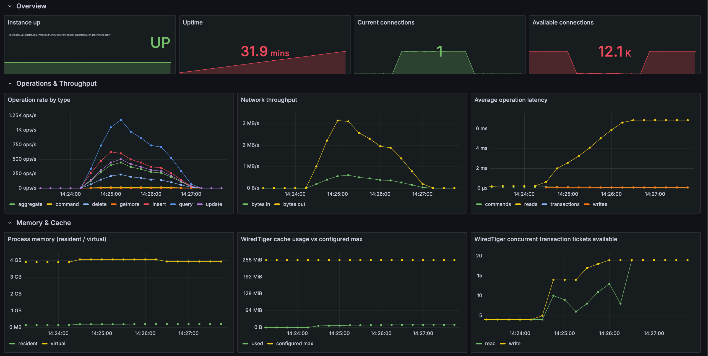
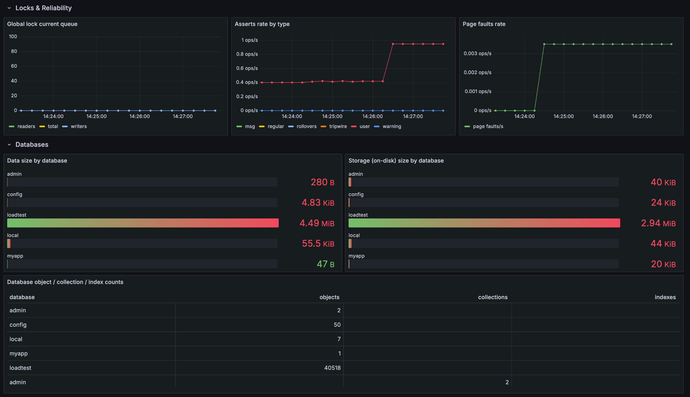

# Лабораторная работа №1 — Эксплуатация MongoDB

Отчёт о реализации. Все операции над ВМ выполняются из Ansible-плейбуков с хоста.

```
lab1/
├── ansible.cfg, inventory.ini      # подключение к ВМ
├── install-mongodb.yml             # Часть 1: установка и настройка
├── restart-server.yml              # Часть 1: перезагрузка + проверка доступности
├── manage-rbac.yml                 # Часть 2: роли и пользователи
├── mongodb-backup.yml              # Часть 3: backup/restore
├── templates/                      # mongod.conf.j2, mongod.service.j2
├── monitoring/                     # Часть 4: мониторинг
│   ├── docker-compose.yml          # mongodb-exporter + prometheus + grafana
│   ├── prometheus/prometheus.yml
│   └── grafana/provisioning + dashboards/mongodb-lab-overview.json
├── load-test/                      # Часть 4: генератор нагрузки
│   └── generate_load.py
└── distfiles/                      # дистрибутивы mongod/mongosh/database-tools (*.tgz)
```

## Часть 1. Базовая настройка

install-mongodb.yml — плейбук для установки MongoDB 9.0.2 из tar-архива:

- распаковывает mongodb-linux-\*.tgz и mongosh-\*.tgz в /opt, линкует mongod/mongos/mongosh
  в /usr/local/bin;
- создаёт системного пользователя/группу mongodb, каталоги данных и логов;
- рендерит /etc/mongod.conf из templates/mongod.conf.j2 (dbPath, порт, bindIp) и
  /etc/systemd/system/mongod.service из templates/mongod.service.j2;
- systemd: enabled: true включает автозапуск службы mongod;

restart-server.yml — перезагружает ВМ (ansible.builtin.reboot) и проверяет, что
сервис пережил рестарт: ждёт порт 27017, затем mongosh --eval "db.runCommand({ping:1})"
и выводит результат через debug.

Запуск:
```bash
ansible-playbook install-mongodb.yml      # установка/обновление конфигурации
ansible-playbook restart-server.yml       # перезагрузка ВМ + проверка доступности
```

## Часть 2. Управление ролевой моделью

manage-rbac.yml — пять независимых операций через community.mongodb.mongodb_role
/ mongodb_user. Каждая операция висит на отдельном теге и помечена
never, чтобы ничего не выполнялось без явного указания:

| Тег | Что делает |
|---|---|
| create_role / update_role | создаёт роль или заменяет её набор привилегий (upsert) |
| assign_role | создаёт пользователя (если не существует) и выдаёт ему роль(и) |
| revoke_role | отзывает роль — на вход подаётся итоговый список ролей без отозванной |
| grant_collection_access | роль, ограниченная одной коллекцией, и пользователь под неё |
| cleanup | удаляет созданного пользователя и роль |

Пример:
```bash
ansible-playbook manage-rbac.yml --tags create_role \
  -e '{"role_name":"appReadWrite","role_database":"myapp",
       "role_privileges":[{"resource":{"db":"myapp","collection":""},
                           "actions":["find","insert","update","remove"]}]}'
ansible-playbook manage-rbac.yml --tags assign_role \
  -e '{"target_user":"appuser","target_user_password":"Secret123!",
       "target_user_auth_db":"myapp","user_roles":[{"db":"myapp","role":"appReadWrite"}]}'
```

## Часть 3. Резервное копирование и восстановление

mongodb-backup.yml — устанавливает mongodb-database-tools и реализовывает три операции:

- backup_one — mongodump одной базы (backup_database) в
  /var/backups/mongodb/<timestamp>/;
- backup_all — получает список баз через mongosh --eval listDatabases, исключая
  admin/local/config, и делает mongodump по каждой в тот же timestamp-каталог;
- restore_collection — находит последний backup-каталог и восстанавливает конкретную коллекцию из него через mongorestore --drop.

```bash
ansible-playbook mongodb-backup.yml --tags backup_all
ansible-playbook mongodb-backup.yml --tags restore_collection \
  -e 'restore_database=myapp restore_collection=orders'
```

## Часть 4. Мониторинг

### Экспортер

percona/mongodb_exporter:0.44 (monitoring/docker-compose.yml)

### Метрики и дашборд

monitoring/grafana/dashboards/mongodb-lab-overview.json — кастомный дашборд, 13 панелей

Prometheus (prom/prometheus:v3.0.1) скрейпит экспортер каждые 15с; Grafana
(grafana/grafana-oss:11.3.1) поднимает датасорс и дашборд через provisioning
(grafana/provisioning/{datasources,dashboards}).

```bash
cd monitoring
docker compose up -d
http://localhost:3000   # admin/admin
```

### Нагрузка

load-test/generate_load.py — Python/pymongo-скрипт, запускается с хоста.

```bash
cd load-test
python3 -m venv .venv && source .venv/bin/activate
pip install -r requirements.txt
python3 generate_load.py --workers 50 --duration 120
```

Во время прогона на дашборде наглядно растут: Current connections (до ~150 из-за
служебных соединений драйвера), Operation rate by type, Average operation latency,
а при достаточном объёме сидированных данных — Page faults rate (нехватка RAM под
WiredTiger cache) и WiredTiger cache usage vs configured max.
Также виден рост количества подключений к бд до ~150, при том что нагрузочный тест
запуускался с 50 воркерами, т.е. на одну сессию mongo держит 3 подключения.



Виден всплеск Operation rate by type (до ~1.25K ops/s, смесь query/insert/update/delete/
aggregate/getmore), рост Network throughput и Average operation latency (с ~0 до 6мс по
мере роста очереди), а также постепенный рост занятых WiredTiger concurrent transaction
tickets.



Page faults rate и Asserts rate by type (тип user) переходят в
ненулевое значение в момент старта нагрузки — память/валидация операций начинают
ощущать нагрузку. В блоке Databases видно, что весь объём данных нагрузочного теста
находится в loadtest (4.49 MiB / 40518 документов).
