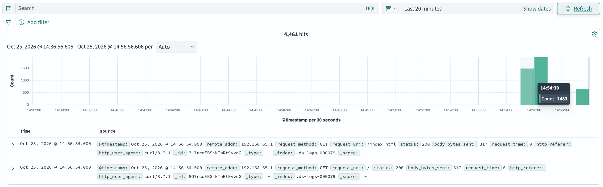
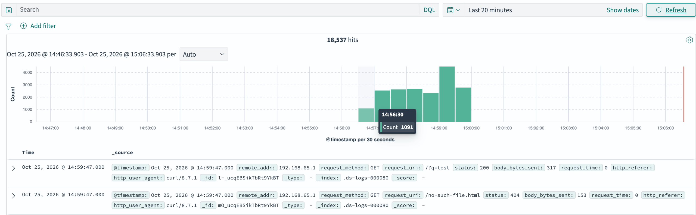
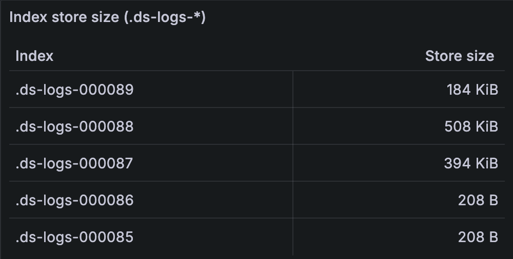
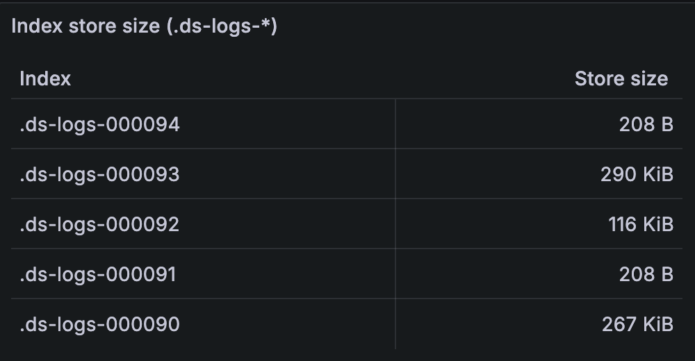
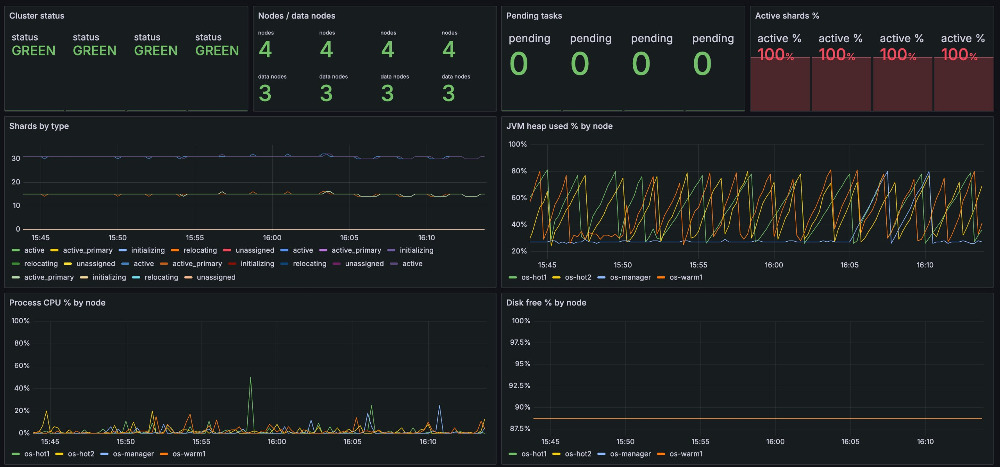
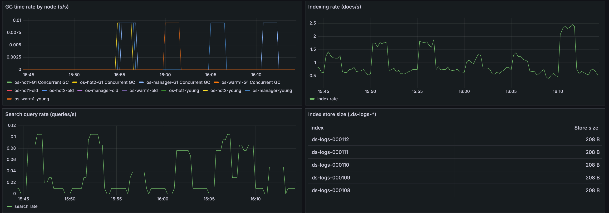

# Lab 2 — OpenSearch

## Структура проекта

```
lab2/
├── docker-compose.yml              # все сервисы: кластер OpenSearch, Dashboards,
│                                    # security-init, nginx, Fluent Bit, Prometheus, Grafana
├── opensearch.Dockerfile           # образ OpenSearch + плагин prometheus-exporter
├── generate-certs.sh               # генерация root CA + TLS-сертификатов
├── generate-load.sh                # генератор нагрузки на nginx
├── setup.sh                        # ISM-политика + шаблон индекса + data stream "logs"
├── .env                            # пароли и версия OpenSearch
├── .gitignore
│
├── certs/                          # сертификаты
│   ├── root-ca.pem / root-ca-key.pem
│   ├── node.pem / node-key.pem     # общий сертификат узлов
│   └── admin.pem / admin-key.pem   # mTLS-identity администратора
│
├── config/
│   ├── opensearch.yml              # общий конфиг узлов: TLS, security, discovery
│   ├── opensearch-security/        # роли, пользователи, role-mapping
│   │   ├── roles.yml
│   │   ├── roles_mapping.yml
│   │   ├── internal_users.yml
│   │   ├── config.yml / tenants.yml / action_groups.yml
│   │   └── nodes_dn.yml / whitelist.yml / allowlist.yml
│   └── dashboards/
│       └── opensearch_dashboards.yml
│
├── nginx/
│   ├── nginx.conf
│   └── html/index.html
│
├── fluent-bit/
│   ├── fluent-bit.conf
│   └── parsers.conf
│
├── prometheus/
│   ├── prometheus.yml
│   └── secrets/monitor_password.txt
│
└── grafana/
    └── provisioning/
        ├── datasources/prometheus.yml
        └── dashboards/
            ├── dashboards.yml
            └── opensearch-lab2.json
```

## Быстрый старт

```bash
./generate-certs.sh

cat > .env <<EOF
OPENSEARCH_VERSION=2.19.6
ADMIN_PASSWORD=<пароль администратора>
WRITER_PASSWORD=<пароль writer_user>
READER_PASSWORD=<пароль reader_user>
MONITOR_PASSWORD=<пароль monitor_user>
GRAFANA_ADMIN_PASSWORD=<пароль администратора Grafana>
EOF

# Если паролей для writer/reader/monitor ещё нет — захешировать их
#   docker run --rm -e PW="$READER_PASSWORD" opensearchproject/opensearch:2.19.6 \
#     /usr/share/opensearch/plugins/opensearch-security/tools/hash.sh -p "$PW"

docker compose up -d

# ISM-политика, шаблон индекса, data stream nginx-логов
./setup.sh

curl -sk -u "admin:${ADMIN_PASSWORD}" https://localhost:9200/_cluster/health?pretty
```

## Точки входа

| Сервис | Адрес | Доступ |
|---|---|---|
| OpenSearch REST | https://localhost:9200 | `admin` / `${ADMIN_PASSWORD}` |
| OpenSearch Dashboards | http://localhost:5601 | `admin` / `${ADMIN_PASSWORD}` |
| nginx (тестовая страница) | http://localhost:8080 | — |
| Prometheus | http://localhost:9091 | — |
| Grafana | http://localhost:3002 | `admin` / `${GRAFANA_ADMIN_PASSWORD}` |

```bash
curl -sk -u "admin:${ADMIN_PASSWORD}" "https://localhost:9200/_cat/nodes?v&h=name,node.role,master"
```

## Роли

| Роль | Права | Пользователь |
|---|---|---|
| `logs_writer` | `write` на `logs` / `.ds-logs-*` | `writer_user` |
| `logs_reader` | `read` на `logs*` / `.ds-logs*` | `reader_user` |
| `metrics_monitor` | `cluster_monitor` + `indices_monitor` | `monitor_user` |

Роли и пользователи целиком описаны в
`config/opensearch-security/{roles,roles_mapping,internal_users}.yml` и
применяются в кластер автоматически сервисом `security-init` при каждом
`docker compose up`. После ручного редактирования этих файлов
на уже запущенном кластере нужно пересоздать сервис:

```bash
docker compose up -d --force-recreate security-init
```

Проверка прав:

```bash
curl -sk -u "writer_user:${WRITER_PASSWORD}" -X POST https://localhost:9200/logs/_doc -H 'Content-Type: application/json' -d '{"msg":"x","@timestamp":"2026-10-25T12:00:00Z"}' # 201
curl -sk -u "writer_user:${WRITER_PASSWORD}" https://localhost:9200/logs/_search -o /dev/null -w "%{http_code}\n"  # 403
```

## Управление индексами

nginx пишет access log в JSON (`log_format json_combined` в
`nginx/nginx.conf`) → Fluent Bit (`fluent-bit/fluent-bit.conf`) читает файл,
отправляет bulk-запросы в OpenSearch в data stream `logs`.

Политика `logs_policy` (создаётся `setup.sh`):
- rollover при размере индекса 1 МБ или возрасте 1 минута
- удаление индекса через 10 минут после его создания;
- `index.routing.allocation.require.temp: hot` в `logs-template` — индексы
  логов размещаются только на hot-узлах

## Мониторинг

Образ OpenSearch собран с плагином
[`opensearch-prometheus-exporter`](https://github.com/opensearch-project/opensearch-prometheus-exporter)
(`opensearch.Dockerfile`), версия OpenSearch зафиксирована на `2.19.6`.

```bash
curl -s http://localhost:9091/api/v1/targets | python3 -m json.tool
```

## Генератор нагрузки

```bash
./generate-load.sh                      # 60с, ~5 rps
./generate-load.sh -d 120 -r 20 -c 8    # 120с, ~20 rps, до 8 параллельно
./generate-load.sh -n 500 -c 20         # разом 500 запросов
```

## Отчет

Убедимся что индексы удалаяются по истечению 10 минут: 



У меня не получилось превысить размер индекса в 1мб, я опустил трешхолд до 200кб:  



При минимальном доступном интервале проверки в 1 минуту, размер индекса ожидаемо успевал превысить 200кб.

```bash
index           docs.count store.size
.ds-logs-000092      10704    328.7kb
.ds-logs-000094          0       208b
.ds-logs-000093      11404    447.9kb
.ds-logs-000096       2516    140.7kb
.ds-logs-000095          0    171.8kb
```

Посмотрев подробные логи для .ds-logs-000092 можно заметить что от момента начала записи("start_time" : 1792931282237) до rollover("start_time" : 1792931393274) прошло ~111 секунд.
```json
{
  ".ds-logs-000092" : {
    ...
    "rolled_over" : true,
    "rolled_over_index_name" : ".ds-logs-000093",
    "index_creation_date" : 1792931210436,
    "state" : {
      "name" : "hot",
      "start_time" : 1792931282237
    },
    "action" : {
      "name" : "transition",
      "start_time" : 1792931393274,
      "index" : -1,
      "failed" : false,
      "consumed_retries" : 0,
      "last_retry_time" : 0
    },
    ...
  },
}
```

### Grafana dashboard



