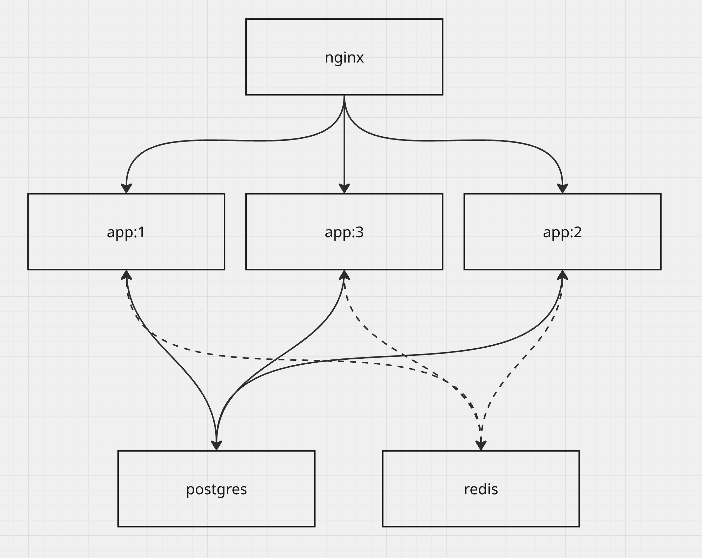
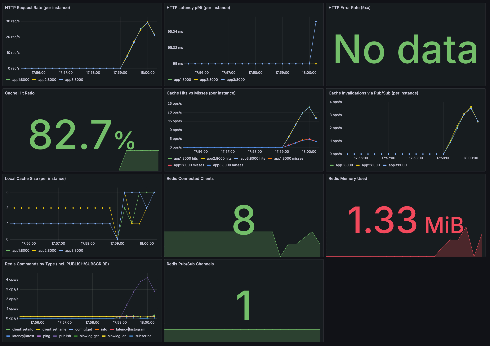

# Lab 3 — Инвалидация кэша в распределённой системе через Redis Pub/Sub

## Предметная область
Распределённые веб-системы с кэшированием: несколько экземпляров сервиса (app1/app2/app3) за nginx, общая БД (PostgreSQL) и локальный in-memory кэш у каждого узла. Типовая проблема - рассинхронизация кэшей между узлами.

## Решаемая задача
Согласованная инвалидация локальных кэшей через Redis Pub/Sub. При `PUT /items/{id}` узел обновляет БД и публикует `item_id` в канал `cache-invalidate`, все узлы подписаны и удаляют запись из своего кэша. Без этого app2/app3 отдавали бы старое значение (`source: cache`) до истечения TTL/рестарта.

## Архитектура



- **GET /items/{id}** — сначала смотрит в локальный кэш процесса, при промахе
  читает Postgres и кладёт значение в кэш.
- **PUT /items/{id}** — обновляет Postgres и публикует `item_id` в Redis-канал
  `cache-invalidate`.
- Каждый инстанс в фоне слушает этот канал и при получении сообщения удаляет запись из своего кэша

## Структура проекта

```
lab3/
├── app/                     # FastAPI-сервис
│   ├── main.py              # эндпоинты, pub/sub-подписчик, Prometheus-метрики
│   ├── cache.py             # локальный in-memory кэш
│   ├── requirements.txt
│   └── Dockerfile
├── nginx/nginx.conf         # round-robin между app1/app2/app3
├── init.sql                 # схема Postgres
├── monitoring/
│   ├── prometheus/prometheus.yml
│   └── grafana/provisioning/
│       ├── datasources/
│       └── dashboards/
├── load-test/
│   ├── generate_load.py     # генератор нагрузки (aiohttp)
│   └── requirements.txt
├── test_cache_invalidation.py  # end-to-end тест
├── docker-compose.yml
└── .env
```

## Запуск

```bash
docker compose up --build -d
```

| Сервис           | Адрес                   | Назначение                                   |
|------------------|-------------------------|-----------------------------------------------|
| `app1/app2/app3` | :8001 / :8002 / :8003   | 3 независимых экземпляра FastAPI-сервиса      |
| `nginx`          | http://localhost:8090   | балансировка round-robin между app1/app2/app3 |
| `postgres`       | (внутри сети)           | хранилище товаров                             |
| `redis`          | (внутри сети)           | pub/sub канал инвалидации                     |
| `redis-exporter` | (внутри сети)           | метрики Redis для Prometheus                  |
| `prometheus`     | http://localhost:9090   | сбор метрик приложения и Redis                |
| `grafana`        | http://localhost:3001   | дашборд (`admin` / `GRAFANA_ADMIN_PASSWORD`)  |

## Демонстрация инвалидации кэша

1. Прогреваем кэш на `app1` и `app2`:

   ```bash
   curl -s localhost:8001/items/1 | jq
   curl -s localhost:8001/items/1 | jq
   curl -s localhost:8002/items/1 | jq
   curl -s localhost:8002/items/1 | jq
   ```

2. Обновляем товар через `app1`:

   ```bash
   curl -s -X PUT localhost:8001/items/1 \
     -H 'Content-Type: application/json' \
     -d '{"name": "Laptop Pro", "price": 1999.00}' | jq
   ```

3. Проверяем, что `app2` (и `app3`) отдают уже свежие данные, а не кэш:

   ```bash
   curl -s localhost:8002/items/1 | jq
   curl -s localhost:8003/items/1 | jq
   ```

### E2E тест

```bash
python3 test_cache_invalidation.py
```


## Нагрузочное тестирование и мониторинг

`load-test/generate_load.py` — генератор смешанной нагрузки

```bash
cd load-test
python3 -m venv .venv && .venv/bin/pip install -r requirements.txt
.venv/bin/python generate_load.py --rps 200 --duration 120
```


