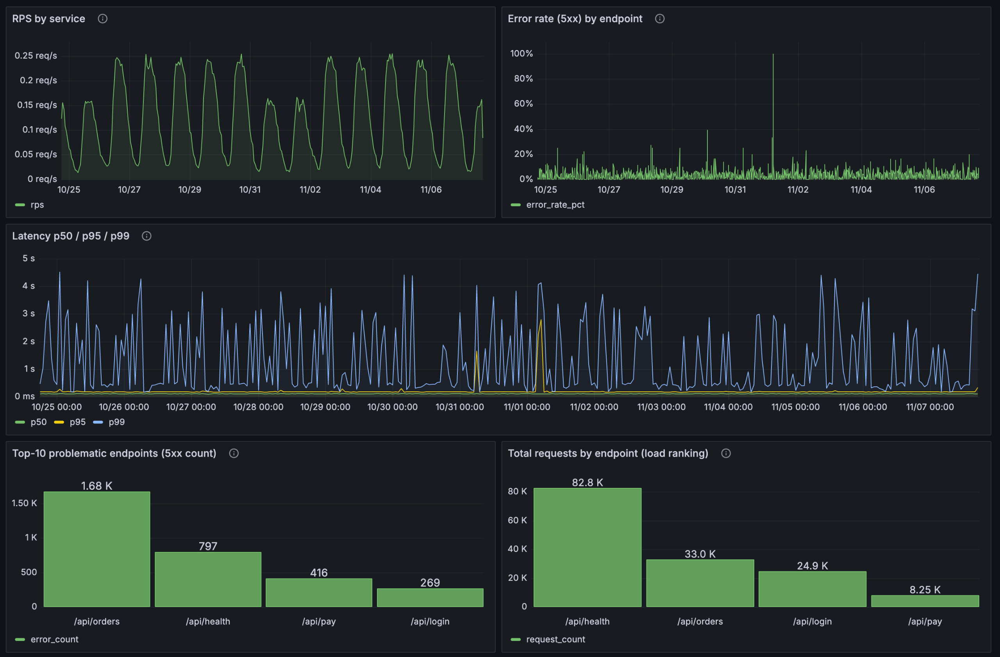

# Lab 4 — ClickHouse для сервисных метрик

## Решаемая задача

Имитация API интернет-магазина (`/api/login`, `/api/orders`,
`/api/pay`, `/api/health`), сохранение событий запросов в ClickHouse и
визуализация RPS / доли ошибок / квантилей задержки / топа проблемных
эндпоинтов.

Система аналитики должна отвечать на вопросы:

- Какая задержка ответа (p50/p95/p99) у сервиса в целом и по каждому
  эндпоинту?
- Какая доля запросов завершается ошибкой (4xx/5xx), по сервису в целом и
  по эндпоинтам?
- Какой эндпоинт наиболее нагружен, а какой отдает 5хх?
- Есть ли во аномальные всплески ошибок/задержок?

## Показатели

Для сервисного уровня аналитики стандартный и достаточный набор — метод
RED (Rate, Errors, Duration):

- Rate — RPS по сервису/эндпоинту: показывает нагрузку и её
  распределение во времени.
- Errors — доля 4xx/5xx.
- Duration — квантили задержки (p50/p95/p99)

## 1. Запуск

```bash
docker compose up -d --build
cd generator
uv run python generate_events.py
```

## 2. Проектирование таблицы `service_logs`

```sql
CREATE TABLE service_logs
(
    timestamp    DateTime64(3),
    service_name LowCardinality(String),
    endpoint     LowCardinality(String),
    method       LowCardinality(String),
    status_code  UInt16,
    duration_ms  UInt32,
    error_type   LowCardinality(String),
    request_id   UUID
)
ENGINE = MergeTree
PARTITION BY toDate(timestamp)
ORDER BY (service_name, endpoint, timestamp)
SETTINGS index_granularity = 8192;
```

- Движок — `MergeTree`: поток логов только пополняется без
  обновления/удаления, приходит большими батчами и читается
  аналитическими агрегирующими запросами.
- Ключ партиционирования — `toDate(timestamp)`: каждая панель дашборда фильтрует по временному диапазону
  (`$__timeFilter(timestamp)`). Партиции по дням позволяют ClickHouse
  отсекать целые партиции вне выбранного окна вместо полного скана таблицы.
- Ключ сортировки — `(service_name, endpoint, timestamp)`:
  `service_name` и `endpoint` имеют очень кардинальность (1 и 4
  различных значений). `timestamp` стоит последним, чтобы внутри одной пары
  (service, endpoint) строки оставались упорядочены по времени и вычисления квантилей.
- Типы: `DateTime64(3)` для анализа задержки с точностью до 3
  миллисекунд; `LowCardinality(String)` для часто повторяющихся
  строковых значений;
  `UInt16`/`UInt32`, для HTTP статус-кодов и задержек; `UUID` для
  `request_id`.

## 3. Генератор событий

`python3 generate_events.py`

| endpoint | доля трафика | 5xx % | 4xx % | p95 (мс) | p99 (мс) |
|---|---|---|---|---|---|
| /api/health | 55.6% | 0.96 | 0 | 175 | 2231 |
| /api/orders | 22.2% | 5.09 | 0 | 231 | 2259 |
| /api/login  | 16.7% | 1.08 | 9.53 | 177 | 2017 |
| /api/pay    | 5.5%  | 5.05 | 0 | 219 | 2727 |

## 4. Мониторинг Grafana

Grafana на http://localhost:3001 (admin/admin)


