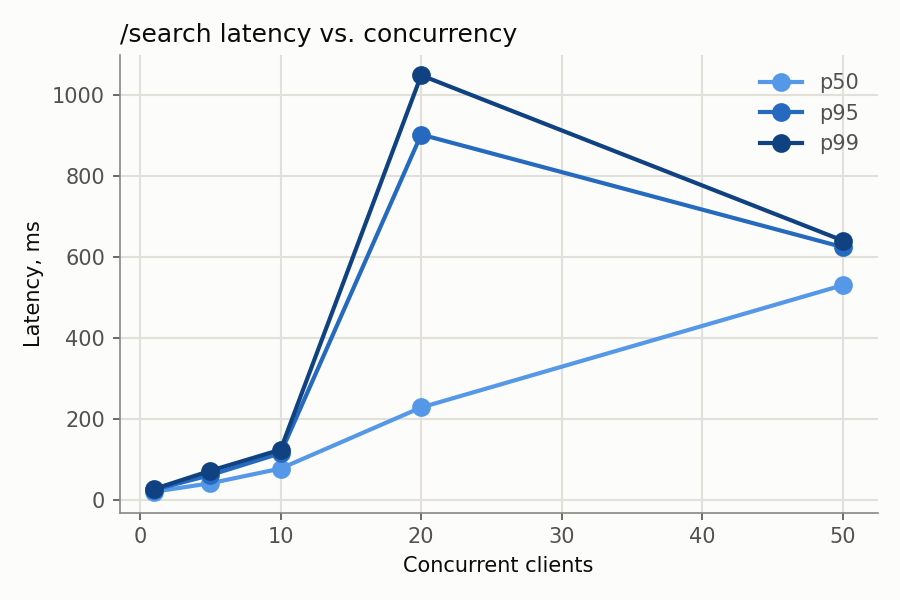
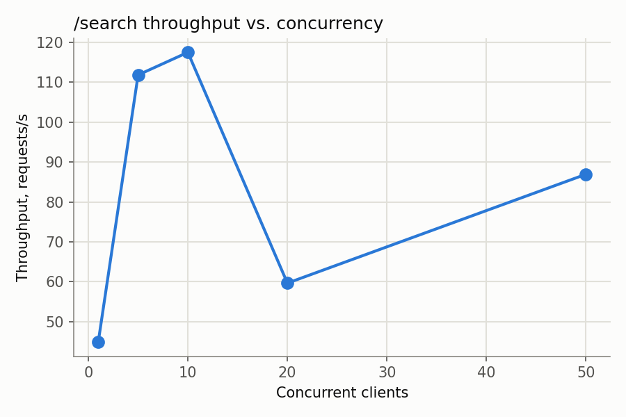
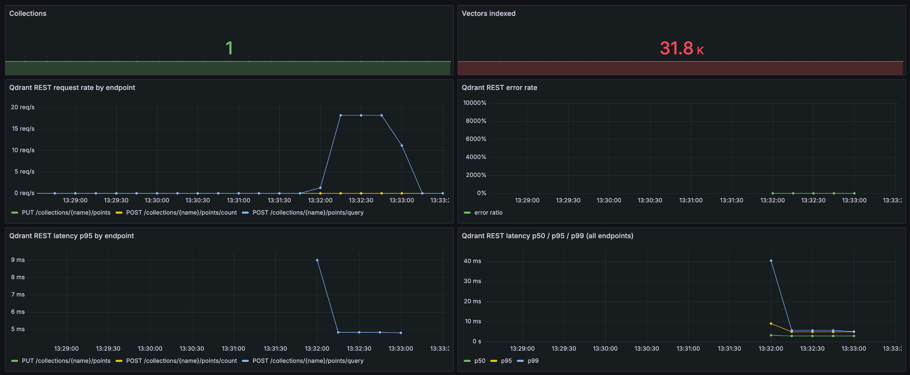
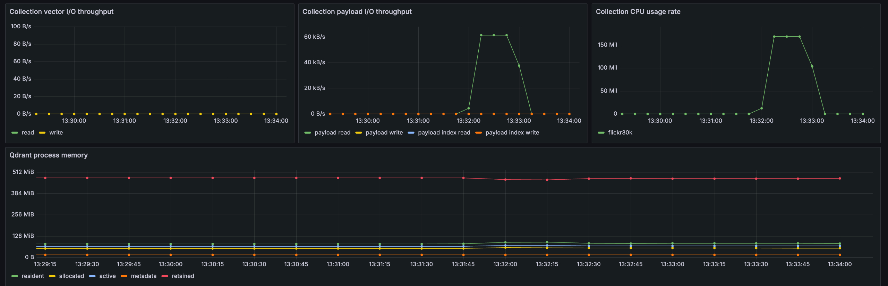

# Flickr30k: поиск изображений по текстовому запросу (CLIP + Qdrant)

## Решаемая задача

Семантический поиск изображений по произвольному
текстовому запросу на естественном языке. Пользователь вводит, например,
«a dog running on the beach», система возвращает top-k изображений из
коллекции Flickr30k, релевантных по смыслу на основе общего для текста и изображений
векторного пространства CLIP.

### Функциональные требования

- Принять произвольный текстовый запрос на естественном языке и вернуть top-k
  изображений, отсортированных по убыванию релевантности, вместе с
  метаданными (caption, filename, score).
- Поиск — ранжирование по смысловой близости, а не точное совпадение
  ключевых слов.

## Обоснование выбора типа хранилища

### Почему Qdrant

| технология | почему не подошла здесь |
|---|---|
| pgvector (расширение Postgres) | оправдан, если нужна транзакционность и join с реляционными данными; здесь единственная сущность — «изображение + вектор + метаданные», join'ы не нужны |
| Elasticsearch/OpenSearch kNN | оптимизирован и используется для полнтекстового поиска (BM25); векторный поиск — доп. плагин |

Qdrant :

1. Специализированная векторная БД "из коробки" — HNSW-индекс, REST + gRPC
   API, поддержка `Distance.COSINE` нативно.
2. Отдаёт нативные Prometheus-метрики на `/metrics` без сторонних
   экспортёров.
3. Payload хранится рядом с вектором в той же точке (документо-ориентированная
   модель: id → вектор + произвольный JSON-payload) — удобно для хранения
   caption/filename/image_id без отдельной таблицы и join'ов.

## Датасет

[`lance-format/flickr30k-lance`](https://huggingface.co/datasets/lance-format/flickr30k-lance)
(31 783 строки, 2.54 ГБ, один `train`-сплит).

| колонка | тип | описание |
|---|---|---|
| `image` | binary | JPEG-байты |
| `caption` / `captions` | string / list | каноническое описание, по которому взят `text_emb` / все 5 описаний |
| `image_emb` | `float32[512]` | готовый CLIP-эмбеддинг изображения, cosine-norm |
| `text_emb` | `float32[512]` | готовый CLIP-эмбеддинг канонической подписи |

Скачать датасет:
```bash
python scripts/download_dataset.py
```

## Qdrant

```bash
docker compose up -d qdrant
```

volume в `./qdrant_storage`

## Загрузка эмбеддингов в Qdrant

```bash
python scripts/ingest_qdrant.py --recreate
```

Загружает датасет в Qdrant как вектор точки берет `image_emb` и 
сохраняет изображения в `data/images/<id>.jpg` для дальнейшего использования в сервисе.

## Метрика поиска

В качестве метрики поиска используется косинусное расстояние `Distance.COSINE`, Потому что
эмбеддинги CLIP (оба — `image_emb` и наш текстовый) уже L2-нормализованы. 
Для нормализованных векторов косинусная близость — это просто скалярное произведение, 
ровно та величина, на которую CLIP обучался.

## Метрики качества поиска

### Какие метрики и почему

Задача — ранжирование: для текстового запроса пользователь
смотрит top-k картинок, и важно, окажется ли релевантная картинка близко к
началу списка. Отсюда:

- Recall@K (K = 1, 5, 10) — доля запросов, где корректное изображение
  попало в top-K.
- MRR (Mean Reciprocal Rank) — чувствительна к точной позиции попадания
  по всему списку, а не только к факту «попал/не попал» в фиксированный K.
- Median rank — устойчивая к выбросам метрика,
  показывающая медианное значение позиции релевантного ответа.
- Дополнительно — задержка запроса поиска

### Протокол

У Flickr30k 5 подписей на изображение. Каноническая подпись (`caption`)
использована для построения `text_emb` датасета. 
Вместо нее в `scripts/evaluate.py` мы берём 4
оставшиеся подписи как синтетические пользовательские запросы, 
кодируем их нашим CLIP-кодировщиком и ищем в Qdrant среди всех 31 783 `image_emb`

```bash
python scripts/evaluate.py --n-queries 1000
```

### Результаты (1000 случайных запросов, вся коллекция 31 783 картинок)

| метрика | значение |
|---|---|
| Recall@1 | 0.255 |
| Recall@5 | 0.454 |
| Recall@10 | 0.540 |
| MRR | 0.380 |
| Median rank | 8.0 |
| Средняя задержка запроса (encode + search) | 17.1 мс |
| p95 задержка запроса | 22.5 мс |

## Нагрузочное тестирование

```bash
uvicorn app.search_api:app --host 0.0.0.0 --port 8000 &
python scripts/load_test.py --concurrency 1 5 10 20 50 --requests-per-level 200
```

### Результаты

| concurrency | RPS | p50, мс | p95, мс | p99, мс | errors |
|---|---|---|---|---|---|
| 1 | 45.0 | 21.5 | 26.4 | 28.2 | 0% |
| 5 | 111.8 | 42.5 | 62.6 | 73.3 | 0% |
| 10 | 117.5 | 78.8 | 116.6 | 125.5 | 0% |
| 20 | 59.7 | 229.7 | 903.5 | 1049.8 | 0% |
| 50 | 86.9 | 531.8 | 625.4 | 641.5 | 0% |




### Анализ нагрузочного тестирования

Пропускная способность выходит на плато уже при concurrency≈10 (~117 RPS) и
дальше не растёт вместе с задержкой. Причина — в получении эмбедингов
вызов `encode()` защищён `threading.Lock`, потому что
инференс PyTorch/MPS не thread safe.

## Мониторинг (Prometheus + Grafana)

```bash
docker compose up -d qdrant prometheus grafana
```

- Qdrant отдаёт нативные Prometheus-метрики на `/metrics` (`:6333/metrics`) —
  без дополнительной настройки.
- Grafana (`http://localhost:3002`, admin/admin).



